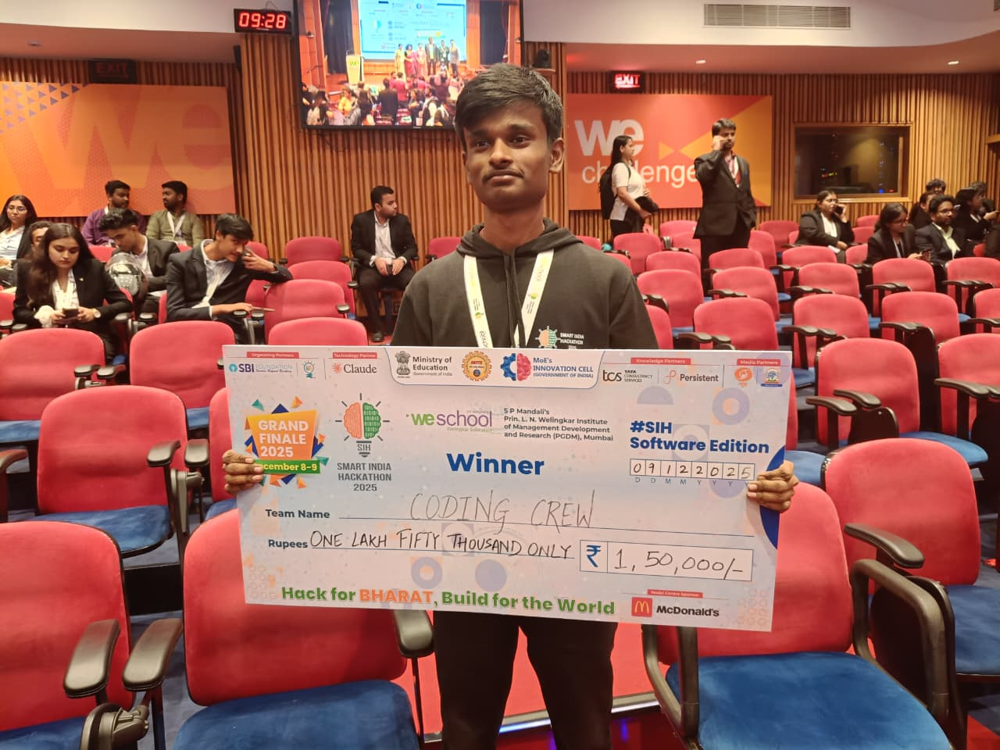
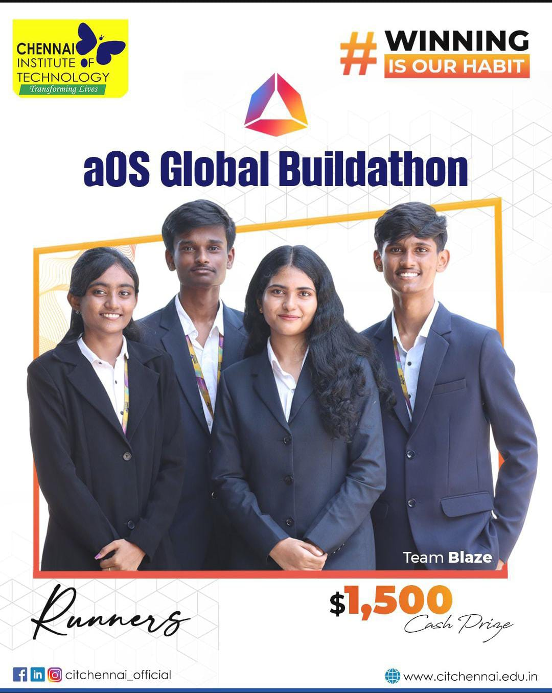

<table>
<tr>
<td width="38%" align="center" valign="middle">

</td>
<td width="62%" valign="middle">

</td>
</tr>
</table>

01 / MILESTONES — Highlights

Slide 01 — Smart India Hackathon 2025

National Winner · Ministry of Defence
Bond — secure communication for defence use cases.
Explore Bond ↓
Slide 02 — aOS Global Buildathon 2025

Runner-up · $1,500 award
NeoSlot — NFT marketplace.

02 / EXPERIENCE
Zenlocare — Software Engineering Intern
ZenoHosp · Hospital Management Platform
- Problem: Hospital teams need dependable workflows that reflect real pharmacy, inventory, and asset operations.
- Solution: Led Pharmacy, Inventory, and Asset modules; built cookie-based SSO with stateless JWT across applications.
- Impact: Platform used across 23 hospitals; reduced p95 latency from 260 ms to 180 ms (30.8%); shipped 5 production releases in 6 months.
- Engineering decision: Worked directly with doctors and hospital staff to understand operational workflows before implementing features.
Java Spring Boot React PostgreSQL AWS JWT

<strong>Kryptos Technology — Software Development Intern</strong>

- Problem: Redundant API calls and distributed backend failures make debugging slower.
- Solution: Added request deduplication and caching; built an MCP-powered agentic workflow for log analysis and failure tracing.
- Impact: Cut redundant API calls by 12%; exposed operational metrics and database execution states as structured tools for multi-step debugging.
- Engineering decision: Exposed operational context through structured tools so the agent could inspect evidence instead of relying on one-shot classification.
Java Spring Boot AWS MCP Agentic AI

03 / PROJECTS

Lumen — Distributed tracing
- Problem: Engineers investigating slow distributed requests need to identify the critical path instead of manually hunting through spans.
- Solution: Built a self-hosted tracing platform that ingests OpenTelemetry spans over gRPC, stores them in Cassandra, reconstructs traces, and analyzes latency.
- Impact: Critical-path, bottleneck, idle-gap, and span self-time analysis; batch writers flush 500 spans every 100 ms.
- Engineering decision: Merged overlapping child-span intervals before calculating self-time to avoid double-counting parallel work; decoupled ingestion from persistence with a bounded queue.
Java Spring Boot OpenTelemetry gRPC Cassandra

Varys — Agentic CI failure investigation
- Problem: A one-shot CI classifier can label a failure but often cannot gather enough evidence to explain the cause.
- Solution: Built a Jenkins investigation agent with an MCP server exposing four structured tools, discovered and chained dynamically over stdio.
- Impact: Correlates build history, test results, and commits to trace failures to likely causes—typically within five reasoning turns.
- Engineering decision: Used structured tools and multi-turn evidence gathering instead of relying on a single prompt or classification step.
Python MCP Jenkins Agentic AI

Bond — Secure communication for defence use cases
- Problem: Sensitive communication requires controlled access and practical coordination.
- Solution: Implemented role-based access for Admin, Officer, and Family; integrated LiveKit with a Matrix (Synapse) homeserver for real-time audio/video alongside encrypted messaging.
- Impact: National Winner at Smart India Hackathon 2025, for a Ministry of Defence problem statement.
- Engineering decision: Focused on explicit role boundaries and administrative oversight; incorporated feedback from Ministry of Defence and Army Cyber Group of India officials who tested the solution.
Node.js React Matrix/Synapse LiveKit Azure
04 / OPEN SOURCE
Jenkins OpenTelemetry Plugin — merged contribution
Issue #1150 · Java · Jenkins · Jelly
- Problem: Plugin icons rendered inconsistently across Jenkins themes.
- Solution: Adopted Jenkins' OSS Symbols dependency and migrated the OpenTelemetry and six observability-backend icons to theme-aware symbols.
- Impact: Updated affected Java descriptors and Jelly views, removed legacy icon registrations, and got the contribution reviewed and merged upstream.
- Engineering decision: Used Jenkins' theme-aware symbol system rather than maintaining separate legacy icon registrations.
Upstream repository · My GitHub contributions
05 / STACK

Languages

Backend & Data

Systems, AI & Infrastructure

06 / RECOGNITION
Achievement	Recognition
Smart India Hackathon 2025	National Winner · Ministry of Defence
aOS Global Buildathon 2025	Runner-up · $1,500 · NeoSlot
MariaDB Hackathon 2025	Finalist · 25 finalists from 2,500+ participants
LeetCode	Knight · 500+ solved · peak rating 1905 · top 4.57%

07 / GITHUB ACTIVITY

08 / CONNECT

Build systems. Understand failure. Measure impact.

