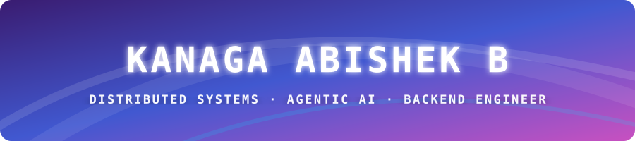
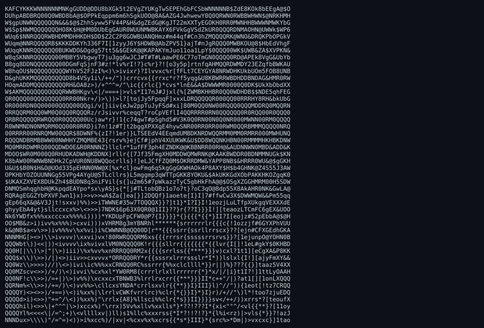

<!-- HERO BANNER -->

  

<!-- TYPEWRITER -->

  

 

<!-- TERMINAL DASHBOARD -->

  <table>
    <tr>
      <td align="center" width="45%" valign="top">
        
      </td>
      <td align="center" width="55%" valign="top">
        
      </td>
    </tr>
  </table>

 

<!-- CONTRIBUTION ACTIVITY -->

  <picture>
    <source
      media="(prefers-color-scheme: dark)"
      srcset="https://raw.githubusercontent.com/kanagaabishek/kanagaabishek/output/github-contribution-grid-snake-dark.svg"
    />
    <source
      media="(prefers-color-scheme: light)"
      srcset="https://raw.githubusercontent.com/kanagaabishek/kanagaabishek/output/github-contribution-grid-snake.svg"
    />
    
  </picture>

 

<!-- ABOUT ME -->
##  About Me

🏆 **Smart India Hackathon 2025 — National Winner, Ministry of Defence** for Bond, a secure defence communication platform.

🎓 B.Tech IT @ Chennai Institute of Technology '28 · **LeetCode Knight** · 1905 peak rating.

💻 Building with **Java, Spring Boot, Agentic AI, MCP, and Distributed Systems**. Open-source contributor to the Jenkins OpenTelemetry Plugin, with a merged upstream contribution.

**Interests:** Java internals · Autonomous AI agents · Backend architecture · Observability · Open Source

---

<!-- EXPERIENCE -->
##  Experience

<!-- FEATURED PROJECTS -->
##  Featured Projects

### Lumen — Distributed Tracing System
A self-hosted, high-throughput distributed tracing alternative to Jaeger and Zipkin designed for high-concurrency span ingestion, bottleneck detection, and granular execution path breakdown.
- Ingests OpenTelemetry spans over both **gRPC** and **HTTP**, storing them in **Apache Cassandra** via a denormalized schema specifically engineered to eliminate hot partitions under heavy write loads.
- Added latency analysis that pinpoints the critical path, bottlenecks, and idle gaps in slow traces, using interval merging to compute self-time without double-counting parallel child calls.
- Decoupled ingestion from storage with a bounded queue and multi-threaded background workers that batch-flush **500 spans every 100 ms**, protecting upstream services from storage backpressure.

*Focus: Distributed Systems • Java • Spring Boot • gRPC • Apache Cassandra • OpenTelemetry*  

  

---

### Varys — Autonomous Agentic CI Failure Investigator
An intelligent autonomous agent that investigates complex Jenkins CI/CD build failures through dynamic multi-turn reasoning and tool use rather than brittle one-shot prompt classification.
- Designed and deployed an MCP server exposing CI test logs, build artifacts, and commit histories as **4 structured tools** discoverable and chained dynamically over `stdio`.
- Traces failures to their root cause by correlating build history, test regressions, and commit diffs, typically resolving issues within **5 reasoning turns**.

*Focus: Agentic AI • Model Context Protocol (MCP) • Python • Jenkins CI • Automated Debugging*  

  

---

### Bond — Secure Defence Communication Platform
An invite-only, end-to-end encrypted military communication platform built for secure hierarchical coordination between command centers, operational officers, and military personnel.
- **Smart India Hackathon 2025 National Winner**: Evaluated, security-tested, and awarded **₹1,50,000** by officials from the **Ministry of Defence** and **Army Cyber Group of India**.
- Implemented strict role-based access control (`Admin → Officer → Family`) with HQ-only cryptographic account provisioning and administrative monitoring features.
- Integrated **LiveKit** alongside a self-hosted **Matrix (Synapse)** homeserver to deliver low-latency encrypted audio/video calling on top of federated messaging.

*Focus: Def-Tech • Secure Communications • Node.js • React • Matrix (Synapse) • LiveKit • Azure • RBAC*  

  

---

### Jenkins OpenTelemetry Plugin — Open Source Contribution
Upstream contribution to the official Jenkins observability ecosystem fixing theme inconsistency across modern UI themes ([Issue #1150](https://github.com/jenkinsci/opentelemetry-plugin)).
- Fixed icon rendering issues across dark and light Jenkins themes by adding Jenkins' OSS Symbols dependency and migrating the core OpenTelemetry icon plus six observability backend icons to theme-aware symbols.
- Updated affected Java descriptors and Jelly views, removing legacy icon registrations; contribution was reviewed and merged upstream.

*Focus: Open Source • Java • Jenkins • Observability • Theme-Aware Symbols*

---

<!-- TECH STACK -->
##  Tech Stack

**Languages**  

**Frameworks & Libraries**  

**Databases, Storage & Streaming**  

**Systems, Observability & Agentic AI**  

**Cloud, DevOps & Tools**  

---

<!-- EDUCATION & CERTIFICATIONS -->
##  Education &amp; Certifications

- 🎓 **B.Tech, Information Technology** — *Chennai Institute of Technology (CIT)* (Expected: May 2028 | **CGPA: 8.1/10**)
- 📜 **Amazon: Data Structures and Algorithms** — *Algorithmic problem solving, asymptotic complexity, advanced data structures*
- 📜 **Amazon: Programming with Java** — *OOP principles, multithreading, concurrency models, Java collections framework*
- 📜 **NPTEL, IIT: Data Analytics with Python** — *Statistical modeling, exploratory data analysis, numerical computing*

---

<!-- COMPETITIVE PROGRAMMING & CONTEST STATS -->
##  Competitive &amp; Contest Stats

  <table>
    <tr>
      <td align="center" width="50%" valign="top">
        
      </td>
      <td align="center" width="50%" valign="top">
        
      </td>
    </tr>
  </table>

 

<!-- LIVE LEETCODE CONTEST CARD -->

  

 

---

<!-- HONORS & ACHIEVEMENTS -->
##  Honors, Hackathons &amp; Leadership

- 🏆 **Smart India Hackathon 2025 — National Winner (Ministry of Defence)**  
  *Dec 2025* | Awarded **₹1,50,000** for building **Bond**, a defence-grade secure communication platform with hierarchical RBAC, LiveKit real-time calling, and Matrix-encrypted messaging.
- 🥈 **aOS Global Buildathon 2025 — Runner-up**  
  *Aug 2025* | Awarded **$1,500** for building **NeoSlot**, a decentralized Web3 NFT marketplace platform.
- 🎯 **MariaDB Hackathon 2025 — Finalist**  
  *Sep 2025* | Selected as one of **25 finalists out of 2,500+ participants** worldwide for distributed database architecture.
- 🤝 **Co-organizer — HackSymmetric ’26**  
  A 48-hour national hackathon at Chennai Institute of Technology conducted in collaboration with **Unstop** and **Major League Hacking (MLH)**.
- ⚡ **Event Coordinator — Runtime Terror**  
  A national-level competitive programming and coding contest organized as part of **Trojans ’25**, coordinating technical problem curation and platform operations.

---

<!-- CONNECT WITH ME -->
##  Connect With Me

