---

  <table>
    <tr>
      <td align="center" width="45%">
        
      </td>
      <td align="center" width="55%">
        
      </td>
    </tr>
  </table>

---

## 👨‍💻 About Me

I'm a Software Engineer and AI Developer from Chennai, currently pursuing B.Tech in Information Technology at Chennai Institute of Technology (CGPA: 8.1/10). I have experience as **Software Engineering Intern at Zenlocare** and **Software Development Intern at Kryptos Technology**, building enterprise healthcare platforms and agentic AI systems. My work lives at the intersection of **distributed systems**, **agentic AI**, and **cloud-native development**.

---

## 🛠️ Tech Stack

**Languages**

**Frameworks & Libraries**

**AI / ML & Voice Tech**

**Cloud & Databases**

**Tools & Protocols**

  <table>
    <tr>
      <td align="center" width="50%" valign="top">
        
      </td>
      <td align="center" width="50%" valign="top">
        
      </td>
    </tr>
  </table>

## 🤝 Connect With Me

