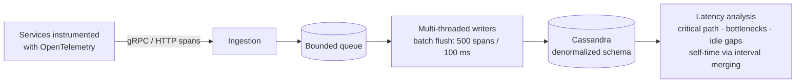
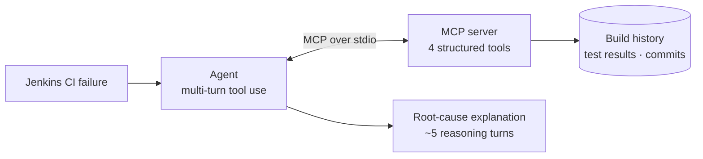

 

  

  

 

<table align="center">
<tr>
<td width="240" align="center" valign="middle">

</td>
<td valign="middle">
<pre>
<b>~/about $ whoami</b>
Software engineer building systems that are
observable, reliable, and useful in production.

build        Java · Spring Boot · APIs · data-heavy services
explore      distributed tracing · OpenTelemetry · concurrency
automate     agentic AI · MCP · developer workflows
contribute   open-source developer tooling

edu          Chennai Institute of Technology
             B.Tech Information Technology · 2028
</pre>
</td>
</tr>
</table>

## Milestones

Smart India Hackathon 2025 · National Winner &nbsp;→&nbsp; <a href="#projects">see Bond</a>

## Experience

<b>Zenlocare · Software Engineering Intern</b> — ZenoHosp

 
<table>
<tr>
<th width="33%" align="left">Problem</th>
<th width="33%" align="left">Solution</th>
<th width="34%" align="left">Impact</th>
</tr>
<tr valign="top">
<td>Hospital workflows must match real pharmacy, inventory, and asset operations.</td>
<td>Led the Pharmacy, Inventory, and Asset modules. Built cookie-based SSO with stateless JWT across apps.</td>
<td>Used across <b>23 hospitals</b> · p95 latency <b>260 → 180 ms</b> · <b>5 releases</b> in 6 months.</td>
</tr>
</table>

<b>Engineering decision:</b> worked directly with doctors and hospital staff to understand operational workflows before implementing features.

<b>Kryptos Technology · Software Development Intern</b>

 
<table>
<tr>
<th width="33%" align="left">Problem</th>
<th width="33%" align="left">Solution</th>
<th width="34%" align="left">Impact</th>
</tr>
<tr valign="top">
<td>Redundant API calls and distributed backend failures slow debugging.</td>
<td>Added request deduplication and caching. Built an MCP-powered log-analysis and failure-tracing workflow.</td>
<td><b>12%</b> fewer redundant API calls · operational metrics and database states exposed for multi-step debugging.</td>
</tr>
</table>

<b>Engineering decision:</b> exposed runtime context through structured tools so an agent could investigate evidence rather than rely on one-shot classification.

## Projects

<table>
<tr valign="top">
<td width="50%">
<h3>LUMEN</h3>
<b>DISTRIBUTED TRACING</b>

<b>Problem</b> Slow distributed requests leave engineers hunting through spans to find the critical path.

<b>Solution</b> Self-hosted OpenTelemetry tracing with gRPC ingestion, Cassandra storage, trace reconstruction, and latency analysis.

<b>Impact</b>

<ul>
<li>Critical path, bottleneck, idle-gap, and self-time analysis</li>
<li>Batch writers flush 500 spans / 100 ms</li>
</ul>

<b>Engineering decision</b> Merge overlapping child-span intervals before computing self-time. Decouple ingestion and persistence with a bounded queue.

<a href="https://github.com/kanagaabishek/lumen"><b>View repository →</b></a>

</td>
<td width="50%">
<h3>VARYS</h3>
<b>AGENTIC CI INVESTIGATION</b>

<b>Problem</b> A one-shot CI classifier labels a failure but may not gather enough evidence to explain its cause.

<b>Solution</b> Jenkins investigation agent with an MCP server exposing four dynamically discoverable tools over stdio.

<b>Impact</b>

<ul>
<li>Correlates build history, tests, and commits</li>
<li>Typically traces likely causes within 5 reasoning turns</li>
</ul>

<b>Engineering decision</b> Use structured tools and multi-turn evidence gathering instead of a single prompt or classification step.

<a href="https://github.com/kanagaabishek/Varys"><b>View repository →</b></a>

</td>
</tr>
<tr valign="top">
<td colspan="2">
<h3>BOND</h3>
<b>DEFENCE COMMUNICATION · SIH 2025 NATIONAL WINNER</b>

<b>Problem</b> — Sensitive communication needs controlled access and practical coordination.

<b>Solution</b> — Implemented Admin → Officer → Family roles, HQ-only account creation, and LiveKit audio/video integrated with Matrix (Synapse).

<b>Impact</b> — SIH 2025 National Winner, Ministry of Defence problem statement.

<b>Engineering decision</b> — Prioritized explicit role boundaries and administrative oversight, incorporating feedback from officials who tested the solution.

Source and deployment details are intentionally limited for security reasons.
</td>
</tr>
</table>

<b>▶ Lumen: architecture</b>

<b>▶ Varys: investigation loop</b>

## Open Source

<b>Jenkins OpenTelemetry Plugin</b> · merged upstream contribution

 
<table>
<tr valign="top">
<td width="50%">

<b>Problem</b> Plugin icons rendered inconsistently across Jenkins themes.

<b>Solution</b> Adopted Jenkins' OSS Symbols dependency and migrated the OpenTelemetry and six observability-backend icons to theme-aware symbols.

</td>
<td width="50%">

<b>Impact</b> Updated Java descriptors and Jelly views, removed legacy registrations. Reviewed and merged upstream.

<b>Engineering decision</b> Use Jenkins' existing theme-aware symbol system instead of maintaining separate legacy icon registrations.

</td>
</tr>
</table>

<a href="https://github.com/jenkinsci/opentelemetry-plugin/issues/1150">Issue #1150</a> ·
<a href="https://github.com/jenkinsci/opentelemetry-plugin/pull/1305">Pull request #1305</a> ·
<a href="https://github.com/jenkinsci/opentelemetry-plugin">Upstream repository</a> ·
<a href="https://github.com/jenkinsci/opentelemetry-plugin/pulls?q=author%3Akanagaabishek">My contributions</a>

## Stack

<table>
<tr><td align="right"><b>LANGUAGES</b></td><td>

</td></tr>
<tr><td align="right"><b>BACKEND &amp; DATA</b></td><td>

</td></tr>
<tr><td align="right"><b>SYSTEMS, AI &amp; INFRA</b></td><td>

</td></tr>
</table>

## Recognition

<table>
<tr><th align="left">Achievement</th><th align="left">Result</th></tr>
<tr><td>Smart India Hackathon 2025</td><td>National Winner · Ministry of Defence</td></tr>
<tr><td>aOS Global Buildathon 2025</td><td>Runner-up · $1,500 · NeoSlot</td></tr>
<tr><td>MariaDB Hackathon 2025</td><td>Finalist · 25 from 2,500+ participants</td></tr>
<tr><td>LeetCode</td><td>Knight · 500+ solved · peak 1905 · top 4.57%</td></tr>
</table>

## Activity

Generated from real GitHub data and refreshed daily by GitHub Actions.

  

<b>▶ Languages &amp; notable contributions</b>

 

 

  

<code>Build systems. Understand failure. Measure impact.</code>

